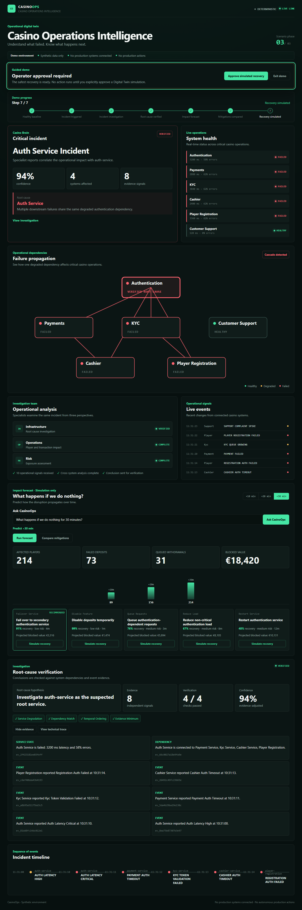

# CasinoOps — AI-Powered Casino Operations Digital Twin

[Try the live demo](https://casinoops.tech) · [Watch the demo](#demo-video) · [Project status](PROJECT_STATUS.md) · [Next steps](NEXT_STEPS.md)

**Understand what failed. Know what happens next.**

> The deployment supports live AI with an explicit deterministic emergency fallback. The interface always identifies which mode produced the current run.

CasinoOps connects operational signals across casino systems to identify cascading incidents, verify their root cause, predict their impact and safely test recovery strategies before touching production.



## Judge quick look

| Item | Value |
|---|---|
| Product | AI-powered casino operations digital twin |
| Live demo | [casinoops.tech](https://casinoops.tech) |
| Specialist model | Muse Spark Open via Baseten |
| Central reasoning | Muse Wonder via Meta Model API |
| Key innovation | Tool-grounded agents with mandatory deterministic verification |
| Source of truth | Deterministic digital twin state, dependencies and event timing |
| Safety | Read-only AI tools, operator approval and simulation-only recovery |
| Main demo | Authentication cascade → impact forecast → recovery |

## The problem

A single degraded dependency can surface as unrelated failures across authentication, payments, KYC, cashier and player registration. Operations teams see the symptoms first; finding the shared cause and understanding the business impact takes time.

CasinoOps turns that fragmented incident into one auditable operational story:

1. detect the cascading failure;
2. investigate system dependencies with specialist agents;
3. verify the root cause against evidence;
4. predict the impact of doing nothing;
5. compare recovery strategies inside a digital twin;
6. require operator approval before simulating recovery.

## Why Meta models?

| Model | Role |
|---|---|
| **Muse Spark Open via Baseten** | Specialist investigation, structured evidence gathering and operational analysis |
| **Meta Muse Wonder** | Casino Brain correlation, verified incident synthesis and natural-language decision-support planning |

All model output is schema-validated. Root-cause confidence is capped by a deterministic evidence verifier, and agents have no tool that can change a production system.

## Verifiable agent architecture

```text
Casino event stream
        ↓
Specialist agents
        ↓
PLAN → READ-ONLY TOOL → OBSERVE
        ↓
Evidence with provenance
        ↓
Mandatory deterministic verification
        ↓
Verified incident
        ↓
Casino Brain
        ↓
Prediction / mitigation decision support
        ↓
Human approval
        ↓
Digital Twin recovery simulation
```

The verifier is enforced by the runtime, not selected by the model. It checks service degradation, shared dependencies, temporal ordering and the evidence threshold before Casino Brain can receive an incident.

## Safety boundaries

- Synthetic casino data only.
- No production casino infrastructure is connected.
- Specialist agents use a strict read-only tool allow-list.
- Every root cause requires deterministic verification.
- Casino Brain can predict and compare, but cannot execute mitigation.
- Recovery requires explicit operator approval and runs only inside the digital twin.
- API keys remain server-side and are excluded from Git, browser payloads and images.

## Three-minute demo story

`Healthy casino → authentication degradation → downstream failures → verified root cause → +30 minute impact → mitigation comparison → operator approval → simulated recovery`

Choose **Start live demo** on the public site. A six-step coach-mark tour explains each decision point and pauses before recovery until the operator explicitly approves it.

<a id="demo-video"></a>
## Demo video

The final three-minute submission video will be linked here. The recording script and acceptance checklist live in [JUDGE_EXPERIENCE.md](JUDGE_EXPERIENCE.md).

## Requirements

- Node.js 22+
- pnpm 10+

## Start locally

```bash
pnpm install
copy .env.example .env
pnpm dev
```

Mock mode is the default and never spends model credits. The dashboard opens at `http://127.0.0.1:5173` and the API listens on `http://127.0.0.1:3000`.

## Docker Compose (recommended)

Docker Compose starts a non-root Fastify API container and a non-root Nginx web container:

```bash
docker compose up --build
```

Open `http://127.0.0.1:8088`. Stop the stack with `docker compose down`.

The opening screen offers two paths: **Guided Demo** automatically runs the deterministic incident through verification, forecast and mitigation comparison before pausing for explicit recovery approval. A six-step, skippable coach-mark tour explains each highlighted panel and directs the judge to the approval action. **Explore CasinoOps** exposes all manual operator controls.

The host ports are configurable without editing the Compose file:

```env
WEB_PORT=8088
API_PORT=3000
```

The services have independent health checks and communicate over a private Compose network. Host ports bind to localhost only and containers cannot gain new privileges. This keeps the deployment ready for a later Kubernetes migration without requiring a local cluster for MVP development.

Start the deterministic scenario:

```bash
curl -X POST http://127.0.0.1:3000/simulation/scenario/auth-cascade-failure
```

Inspect generated events at `GET /events`, specialist output at `GET /agent-reports`, auditable investigation steps at `GET /agent-traces`, and correlated Casino Brain output at `GET /incidents`. WebSocket clients can connect to `ws://127.0.0.1:3000/ws`.

After Casino Brain detects an incident, run deterministic digital-twin analysis:

```bash
curl -X POST http://127.0.0.1:3000/simulation/predict \
  -H "content-type: application/json" \
  -d '{"durationMinutes":30}'

curl -X POST http://127.0.0.1:3000/simulation/mitigations \
  -H "content-type: application/json" \
  -d '{"durationMinutes":30}'
```

Prediction horizons are restricted to 1–120 minutes. Mitigation output is simulated only and never performs real infrastructure actions.

Apply a selected strategy to the digital twin after comparing mitigations:

```bash
curl -X POST http://127.0.0.1:3000/simulation/mitigations/failover_service/simulate \
  -H "content-type: application/json" \
  -d '{}'
```

Only allow-listed mitigation actions are accepted. Recovery progresses through deterministic timeline events and is isolated from the specialist-agent input buffers.

## Live Baseten mode

Set `AI_MODE=live`, `BASETEN_API_KEY`, `META_MODEL_API_KEY`, and `META_MODEL` in the ignored `.env` file. Specialist agents use Baseten; Casino Brain uses Meta. Model responses are parsed as JSON and validated.

Keep `AI_FALLBACK_ENABLED=true` for the public demo. If either live provider fails or times out, CasinoOps continues with deterministic responses using the same validated schemas and visibly changes the UI status to **AI FALLBACK**. The fallback is never presented as a live model result; resetting the demo starts a new live attempt.

## Quality checks

```bash
pnpm test
pnpm typecheck
pnpm lint
pnpm build
```

Run the complete judge-facing journey in Chromium. The command reuses a healthy local stack or starts Docker Compose automatically:

```bash
pnpm exec playwright install chromium
pnpm test:e2e
```

Set `E2E_BASE_URL` to run the same browser journey against an already deployed environment.

Run the deterministic Infrastructure Agent smoke suite separately:

```bash
pnpm test:ai
```

It validates authentication correlation, an independent payment-provider incident and a healthy baseline. Live Baseten validation is opt-in and reads credentials from the ignored root `.env` file. Set these values before running it:

```env
AI_TEST_PROVIDER=baseten
BASETEN_API_KEY=your-generated-baseten-key
BASETEN_BASE_URL=https://inference.baseten.co/v1
BASETEN_MODEL=meta-models/muse-spark-open-1026
```

Then run:

```bash
pnpm test:ai
```

Keep `AI_MODE=mock` until the separate Meta Casino Brain credentials are configured. The smoke test can use Baseten independently without enabling live mode for the full application.

Run either live suite independently when diagnosing a provider:

```bash
pnpm test:ai:infrastructure
pnpm test:ai:brain
```

The combined `pnpm test:ai` command runs both suites. Meta configuration uses `META_MODEL_API_KEY`, `META_BASE_URL`, and `META_MODEL` from the ignored root `.env` file. Model requests have a 30-second client timeout and one schema-level retry.

## Read-only agent tools

The API runtime owns a provider-independent allow-listed tool registry backed by cloned digital-twin snapshots:

- `getServiceState`
- `getDependencies`
- `getDependents`
- `getRecentEvents`

Tool inputs and outputs are Zod-validated, payload size is bounded, and sensitive values are redacted. The registry currently exposes no mutation or real-infrastructure operation; it is the deterministic foundation for the upcoming Infrastructure Agent investigation loop.

## Evidence verification

Investigations use shared Zod schemas for the hypothesis, checklist, tool calls, evidence provenance and status. Evidence receives a deterministic immutable ID, is deduplicated by ID, and retains the read-only tool and input that produced it.

The deterministic verifier checks root-service degradation, dependency evidence, temporal ordering and a minimum of three unique evidence items from at least two evidence kinds. A root cause cannot become `verified` without degradation and dependency evidence. Otherwise the result is explicitly `insufficient_evidence` or `rejected`; final confidence is model confidence multiplied by the verification score.

## Infrastructure investigation loop

The runtime Infrastructure Agent uses the same structured action protocol in mock and live modes:

```text
PLAN → TOOL CALL → OBSERVE → VERIFY → REPORT
```

The investigation is limited to four model turns, six tool calls and 25 seconds by default. AI requests receive a real abort signal when the total deadline expires. Failed tool validation becomes an auditable failed observation that the model may correct; it never bypasses the strict tool schema. The enforced evidence policy reads root service state, direct dependents and recent events before finishing.

Run the live Baseten loop check independently with `pnpm test:ai:investigation`.

## Auditable agent trace

Each Infrastructure Agent investigation publishes validated `plan`, `tool_call`, `observation`, `verification`, and `report` events through REST and WebSocket. The dashboard shows the investigation checklist, evidence IDs, verifier checks, and verified status. The trace intentionally contains operational facts only—never hidden model reasoning or raw secrets—and its in-memory history is bounded.

## Evidence-aware Casino Brain

Casino Brain runs only after the Infrastructure investigation reaches `verified` status. It receives the evidence and deterministic verification result, cannot raise confidence above `finalConfidence`, and rejects a root service that conflicts with verified infrastructure evidence.

Its decision-support registry exposes only two read operations:

- `predictOutage`
- `compareMitigations`

Both accept a validated 1–120 minute horizon and call deterministic simulator functions. There is deliberately no `simulateMitigation` tool; applying a strategy to the digital twin remains an explicit operator action.

Ask a natural-language decision-support question after a verified incident exists:

```bash
curl -X POST http://127.0.0.1:3000/casino-brain/query \
  -H "content-type: application/json" \
  -d '{"query":"What happens if the outage continues for 45 minutes?"}'
```

The planner can select only prediction or mitigation comparison. Mitigation responses set `requiresOperatorApproval: true`; they never execute the recommended strategy. Run `pnpm test:ai:query` for the two-query Meta live smoke test.
